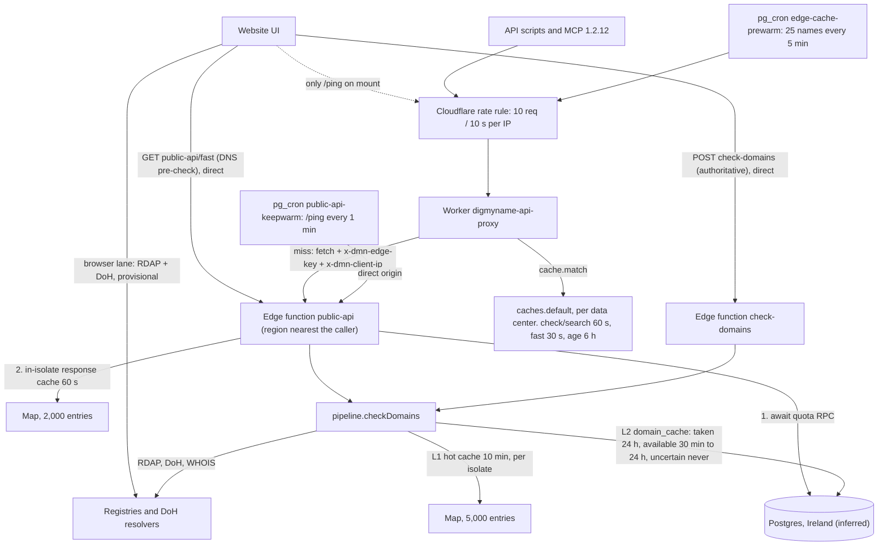

# Performance & caching audit — 2026-11-21

> Read-only audit. Nothing was deployed or patched as part of it. Third-party clients are not named.
> **One production change since, on the owner's instruction:** the `edge-cache-prewarm` cron job was disabled (not deleted) at 2026-11-21 10:47:23Z — see section 9 for the job id, its full command and the rollback.

**Evidence tags:** **M** = measured in this audit · **C** = from code (`file:line`) · **D** = from docs (URL) · **A** = assumed / inferred.
Code lines refer to `origin/main` `64aead2` (the local `main` checkout is 3 commits behind and has no `trusted-caller.ts`).
Worker lines refer to the live script `digmyname-api-proxy` (`worker.js`, sha256 `526fc170…e365`, fetched 2026-11-21 10:23Z).

**Sources used**

| Source | Window / sample |
|---|---|
| Cloudflare zone GraphQL `httpRequestsAdaptiveGroups` (host `api.digmyname.com`) | 2026-11-14 10:00Z → 2026-11-21 10:00Z, sample interval ≈ 1.0–1.5 |
| Cloudflare `workersInvocationsAdaptive` | same 7 days |
| Supabase `net._http_response` (pg_net's own response log) | 2026-11-21 04:31Z → 10:30Z (72 prewarm runs) |
| Supabase `api_quota_daily`, `cron.job`, `domain_cache` | read-only SELECTs, 2026-11-21 |
| `curl` from one EU client (function region `eu-central-1`) | 4 passes × 20 requests, 10:26–10:28Z |
| Globalping public API (HTTP GET probes: Ashburn, Los Angeles, Dublin, Frankfurt, Singapore, São Paulo) | 10:32–10:36Z, 1 probe per city |

---

## 1. TL;DR

- **The prewarm job has not produced a single cache hit.** 0 of 50,371 prewarm requests in 7 days were served from cache, and 0 of 1,526 answered ones in the last 6 hours (M). It warms one data center (DUB, 99.7 % of its requests), where 3 non-prewarm requests arrived all week (M). Verdict: **remove**.
- **`stale-while-revalidate=180` does nothing.** The Workers Cache API does not support it (D), and a request 63–82 s after the store was a MISS 10 times out of 10 (M). The "stale 61 %" in analytics is expired entries, i.e. misses (M + D). The effective edge TTL is a hard 60 s per data center.
- **The edge cache serves one client.** Hit rate by client over 7 days: prewarm 0 %, one bulk client 42 %, everyone else **1.2 %** (458 of 38,145), MCP 0 of 47 (M). **The website's search does not use `api.digmyname.com` at all** (C).
- **The largest latency cost is the origin's region, not the cache.** The edge function runs next to the caller while the database sits in Ireland (A, inferred). A fresh `.com` from the US / Asia / Brazil took a median **1,060 ms** to first byte; pinned to `eu-west-1` it took **339 ms** — faster in 16 pairs out of 16 (M, direct origin).
- **Every origin request waits for the quota write before doing anything**, including answers already in the isolate's memory: 45–105 ms from `eu-central-1`, 122–671 ms from regions outside Europe (M). Meanwhile 15 of 47 MCP requests (32 %) got `429` (M).

---

## 2. Current state



| # | Cache layer | Where | TTL | Scope | Evidence |
|---|---|---|---|---|---|
| 1 | UI session cache | browser memory | 5 min, confident verdicts only | one tab | C `src/components/DomainSearch.tsx:61,102-109` |
| 2 | MCP cache | Node process | 30 s check/search, 6 h registrars, 24 h age; uncertain never | one MCP process | C `mcp/src/index.ts:25-27,133-155` |
| 3 | Browser HTTP cache | client | `max-age=60` (+SWR 180, browsers only) | one browser | C `worker.js:113-116` |
| 4 | Edge cache | `caches.default` | 60 s check/search, 30 s fast, 6 h age; 200 without `uncertain` only | **one data center** | C `worker.js:7-12,64-73,96-121` · D [Cache API](https://developers.cloudflare.com/workers/runtime-apis/cache/) |
| 5 | Origin response cache | isolate memory | 60 s, key = path + sorted params | one isolate, one region | C `supabase/functions/public-api/index.ts:266-295` |
| 6 | L1 hot cache | isolate memory | ≤ 10 min | one isolate | C `supabase/functions/_shared/pipeline.ts:1021-1023` |
| 7 | L2 `domain_cache` | Postgres | taken 24 h · available: dns 30 min, rdap/whois 6 h, porkbun/domainr 24 h · uncertain 0 | global | C `pipeline.ts:1002-1015` |

State on 2026-11-21: `domain_cache` 3,694 rows, 1,617 live (910 taken, 707 available), 2,999 written in the last 24 h (M).

Traffic through the edge, 7 days (M):

| Client | Requests | Share | Served from edge cache |
|---|---|---|---|
| `pg_net` (our prewarm) | 50,371 | 39 % | **0** |
| One bulk client (a single user agent) | 33,946 | 26 % | 14,255 (42 %) |
| Everyone else, 200s on cacheable paths | 38,145 | 30 % | 458 (**1.2 %**: `/check` 0.76 %, `/search` 12.8 %) |
| of which `domain-check-skills-mcp/1.2.12` | 47 | — | 0; 15 answered `429` |

Worker invocations: 124,488 in 7 days (17.8k/day), 109,768 origin fetches (88 %). Account-wide Workers peak: 37,500 requests on 2026-11-18 against the 100,000/day free allowance, shared by 6 Workers (M).

---

## 3. Findings

| # | Finding | Evidence | Impact on real-user latency | Cost impact |
|---|---|---|---|---|
| F1 | The website search never touches the edge cache. Authoritative lane = `supabase.functions.invoke("check-domains")` (POST); DNS pre-check = `/public-api/fast` on the Supabase host; first answer = browser lane. `api.digmyname.com` gets only a `/ping` on mount and the `/speed` benchmark. | C `src/lib/domainData.ts:158-161,238` · `DomainSearch.tsx:160` · `LiveBenchmark.tsx:5` · M: 88 `/ping` and 1 `/fast` at the edge in 7 d | Edge cache and prewarm cannot speed up site search. They only concern API and MCP callers. | — |
| F2 | Prewarm never lands on a fresh entry. 7 d: 50,371 requests, 0 with `cacheStatus=hit`. Last 6 h: 1,508 `X-Edge-Cache: MISS`, 18 `BYPASS`, **0 `HIT`**, 274 no response in 5 s. The origin counted 7,189–7,200 `internal` requests on each full day (25 × 288 = 7,200). | M zone analytics · M `net._http_response` · M `api_quota_daily` | None positive. | 7,200 Worker invocations + 7,200 edge-function invocations + 7,200 quota writes per day |
| F3 | Prewarm warms the wrong place. 99.7 % of prewarm requests enter at DUB. Non-prewarm requests at DUB in 7 d: **3** of ~75,600. From 6 Globalping cities, a prewarmed name 149 s after a run was a MISS in all 6, DUB included. | M zone analytics by `coloCode` · M Globalping · D [cache is data-center local](https://developers.cloudflare.com/workers/reference/how-the-cache-works/) | None. | — |
| F4 | `stale-while-revalidate` is not honored by `cache.put` / `cache.match`. Entries stored 10:26:34–38Z: 10/10 HIT at age 33–42 s, 10/10 MISS at 63–82 s (inside the 180 s window). | D [Cache API, note under `put` and `match`](https://developers.cloudflare.com/workers/runtime-apis/cache/) · M curl | Effective TTL is 60 s. With a 300 s prewarm interval, a prewarmed name is fresh ≤ 20 % of the time even in DUB. | — |
| F5 | "Stale 61 %" = lookups that found an expired object. All 75,361 `stale` and 33,767 `miss` lookups returned `504` to the Worker, which then fetched the origin. Real split of 123,831 lookups: 11.9 % hit, 88.1 % miss. 50,065 of the `stale` lookups are the prewarm in DUB. | M zone analytics (`requestSource=edgeWorkerCacheAPI`) · D ["`cache.match` generates a 504 … when missing or expired"](https://developers.cloudflare.com/workers/runtime-apis/cache/) | — | — |
| F6 | The prewarm burst degrades the origin every 5 minutes. 15.2 % of prewarm requests (274/1,800) got no answer in 5 s; 16 origin `503`s in 6 h, all on the 5-minute mark; the keep-warm `/ping` that coincides with a burst timed out 39 of 72 times (54 %) vs 3 of 288 (1 %) off the mark. | M `net._http_response` | Unmeasured for real callers. A caller arriving in those seconds plausibly sees the same slowness (A). Part of it may be pg_net's own contention (A). | Worker wall time p50 0.62 s / p75 2.4 s / p99 7.0 s over all invocations (M; includes `waitUntil`, cannot be split by client) |
| F7 | The cache key is the raw URL: `new Request(url.toString())`. `?domain=Example.com`, a trailing space, a different param order or an extra param are separate entries. The origin normalizes all of these for its own cache. | C `worker.js:65` vs C `public-api/index.ts:169-171,270-273` | Unknown. Query strings are not available to this zone's analytics (Free plan), so the share of non-canonical requests could not be measured. | — |
| F8 | The edge TTL is far shorter than the origin's own trust for taken names (60 s vs 24 h in L2). Repeat demand beyond 60 s exists: 25,296 `stale` lookups outside DUB in 7 d — 19,598 in the bulk client's four colos, ~5,700 elsewhere. | C `pipeline.ts:1002-1004` · M zone analytics | A longer TTL for taken would turn those into 12–65 ms answers. Upper bound for "everyone else": from 1.2 % to roughly 10–15 % hits (A, derived from M). | ~25k fewer origin calls per week (A, derived from M) |
| F9 | The function runs in the caller's nearest region; the data it needs is in one. Direct origin, fresh `.com`, first byte (ms), default → pinned with `x-region: eu-west-1`: Ashburn 641 → 361 · Los Angeles 1,528 → 343 · Singapore 846 → 336 · São Paulo 1,112 → 351 (medians, n = 4 each). Server time 411–1,480 → 86–175 ms. Dublin and Frankfurt: no material change (113–287 vs 148–328). | M Globalping, unique name per probe · D [Supabase regional invocation](https://supabase.com/docs/guides/functions/regional-invocation) · A: DB region inferred from pg_net exiting at DUB and `eu-west-1` having the lowest server time | **−300 to −1,200 ms** on every uncached answer for non-EU callers. ≈ 26 % of non-prewarm edge requests enter at non-EU colos (M). | — |
| F10 | The quota RPC is awaited before the response-cache read and before the pipeline starts. Server time on an in-isolate cache HIT: `eu-west-1` 16–116 ms, `eu-central-1` median 56 ms (n = 22), `us-east-1` 122–671, `us-west-1` 186–635, `ap-southeast-1` 212–549, `sa-east-1` 186–552 ms. `/fast` (the site's pre-check lane) pays it too. | C `public-api/index.ts:503,523,559` before `:569` · M `Server-Timing` | +1 database round trip on every origin request, cached or not. | 1 write per request (2 when refused) |
| F11 | Keep-warm covers one function in one region. `public-api-keepwarm` pings `public-api/ping` on the direct origin every minute. `check-domains` — the site's authoritative lane — has no keep-warm: first call 1.28 s and 0.98 s, then 0.29–0.62 s. Cold isolates in the region test: 4 of 16 default-routed, 0 of 16 pinned. | M `cron.job` · M curl (n = 2 cold samples, weak) · M Globalping | Up to ~1 s on a visitor's first authoritative answer when the isolate is cold (low confidence). | — |
| F12 | Identical concurrent lookups are not coalesced at any layer. The Cache API does not collapse concurrent misses; the origin de-duplicates only the pricing-catalog load, not per-domain lookups. | D [Workers Caching vs Cache API](https://developers.cloudflare.com/workers/cache/limitations/) · C `pipeline.ts:775-799` (the only in-flight guard) | Low at today's volume (A). | Duplicate upstream probes on concurrent identical lookups |
| F13 | A cached L2 row does not stop the upstream probe: probes for every L1 miss start in parallel with the L2 read. So each prewarm request that misses L1 still queries the registry. 8 of the 25 names are `.io` / `.ai` (one registry, known to throttle per IP). | C `pipeline.ts:1313-1350` | — | Up to 7,200 needless registry queries/day from prewarm (A: depends on L1 hit rate) |
| F14 | MCP retries cannot succeed against the edge limit. The rule answers the 11th request in 10 s with `429`, `retry-after: 10`, body `text/plain`. The MCP treats 429 as retryable with 300/600 ms backoff inside a 1.7 s deadline, does not read `Retry-After`, and reports "60 req/min". | M curl burst (10 × 200, then 429) · C `mcp/src/index.ts:28-35,96,113-118,157-163` · M 15 of 47 MCP requests = 429 | An agent checking > 10 names in 10 s loses the rest. Which limit produced the 15 refusals was not identified (A: the edge rule). | Wasted invocations on retries |
| F15 | UI request hygiene is sound: debounce 80 ms (pre-check) / 250 ms (authoritative), superseded searches aborted, 5-min session cache, hydrated rows skip the pre-check. By design a name can be asked by three lanes, and the headline card twice (`verifyPremium`). A full search = 16 `check-domains` + 6 `/fast` requests for 51 domains. | C `DomainSearch.tsx:61-77,217-242,253-262,294-322,357-381,467-478` | — | — |
| F16 | The site preconnects and pings `api.digmyname.com`, a host its search never calls. The Supabase host has its own preconnect, so nothing is missing. | C `index.html:7-9` · `DomainSearch.tsx:156-167` | None; one unused connection per visit. | ~88 Worker invocations/week |
| F17 | The origin labels every 200 `Cache-Control: public, max-age=60`, uncertain ones included. The Worker overrides it with `no-store`; a direct-origin caller with an HTTP cache does not get that protection. | C `public-api/index.ts:162` · `worker.js:123` | — | Honesty guardrail ("uncertain is never cached") is enforced only on the edge path. Also blocks any header-driven cache design. |
| F18 | Cache hits never reach the quota (the Worker returns before the origin fetch). A refused caller is not cached at the edge: each further request costs 1 Worker invocation, 1 function invocation and 2 writes. The edge rule lets one IP send up to 86,400 requests/day. | C `worker.js:67-73,123-131` · C `public-api/index.ts:559-563` · M blocked domains: 1,273 on 11-18, 248 on 11-19 | — | One IP at the rule's ceiling could take ~86 % of the account's daily Workers allowance regardless of the quota |
| F19 | Edge hit vs miss, first byte: HIT 12–65 ms in 6 cities (n = 12), 53 ms median from the EU client (n = 15). MISS: 220–530 ms from Dublin / Frankfurt, 276 ms median from the EU client (n = 20), 489–1,902 ms from the US, Singapore and São Paulo (n = 3 each). | M Globalping · M curl | A hit saves 0.2–1.8 s. It happens for 1.2 % of non-bulk callers. | — |
| F20 | The Worker's own overhead on a miss could not be isolated. It rebuilds headers from scratch, so `X-Cache` and `Server-Timing` from the origin are dropped and an edge MISS cannot be matched to an origin state. | C `worker.js:91-94` | Unknown. Same-city pairs (n = 1): Dublin 231 vs 189 ms, Ashburn 815 vs 783, Singapore 1,169 vs 558. | — |

---

## 4. Recommendations

Ranked by (latency gain × callers affected) / effort. Nothing here was applied.

| # | Change | Expected gain (confidence) | Risk | Rollback | Effort | Touches |
|---|---|---|---|---|---|---|
| R1 | **Pin the function to the database's region.** API: the Worker adds `x-region: eu-west-1` to its origin fetch. Site: `forceFunctionRegion=eu-west-1` on the `check-domains` and `/fast` calls (verified to work; the `x-region` header would fail the preflight, it is not in the CORS allow-list). | Non-EU callers, uncached: median first byte 1,060 → 339 ms on the direct origin (M, n = 16 pairs). Through the Worker and on `check-domains`: same mechanism, not measured (medium). EU: neutral (M). | Single-region dependency: a pinned call is not re-routed during a regional outage (D). Confirm the DB region first. | Remove the header / parameter. | S | Worker source (Cloudflare only) · `src/lib/domainData.ts:160,238` |
| R2 | **Remove `edge-cache-prewarm`.** | No latency lost (0 hits, M). Removes the 5-minute burst (F6). −7,200 Worker invocations/day (−40 % of this Worker), −7,200 function invocations, −7,200 quota writes (high). | The 25 names lose nothing: L2 already holds them for 24 h. The internal-key path in `trusted-caller.ts` becomes unused; leave it. | Re-run migration `20261011120000_prewarm_internal_key.sql`. | S | new migration (`cron.unschedule`) · `docs/DIGMYNAME_ARCHITECTURE.md` §13, §15 |
| R3 | **Do not wait for the quota before working.** Read the response cache first; run the quota RPC in parallel with the pipeline and await it only before answering. Keep a per-isolate "over the cap until 00:00 UTC" memo so a refused caller is stopped before any lookup. | −1 DB round trip per origin request: ~20–120 ms once pinned, 120–670 ms otherwise (M for cached answers; medium for fresh ones). Also speeds the site's `/fast` lane. | A caller crossing the cap triggers one extra lookup per isolate before being refused. | Revert the commit. | S–M | `supabase/functions/public-api/index.ts:503-570` |
| R4 | **TTL by verdict + canonical key in the Worker.** Taken → 6 h at the edge (start at 1 h if preferred); available → 60 s (unchanged); uncertain → never. `/search` takes the shortest TTL of its rows. Key = lower-cased, trimmed, known params only, sorted. Keep `max-age=60` in the response sent to clients. | Bulk client 42 % → ~90 % hits; everyone else 1.2 % → ~10–15 % (A, from M `stale` counts). Each converted request: 0.25–1.9 s → 12–65 ms. | A dropped name can show "taken" up to 6 h longer than today — the safe direction, and L2 already allows 24 h. `for_sale` / price fields on taken rows age the same way. | Redeploy the previous Worker version. | S | Worker source |
| R5 | **MCP: respect the limit it actually hits.** Read `Retry-After`; never retry a 429 inside the deadline; queue calls client-side (≤ 8 per 10 s); fix the "60 req/min" message. | 32 % of MCP requests are 429 today (M, n = 47) → near zero if the edge rule is the cause (A). | Slower bursts for agents that fan out (queued, not failed). | Publish the previous version. | S–M, npm publish by the owner | `mcp/src/index.ts:96-165` |
| R6 | **Keep `check-domains` warm; drop the unused edge ping.** One pg_cron POST per minute (an empty body returns 400 and still boots the isolate), pinned like R1. Remove the mount `/ping` and the `api.digmyname.com` preconnect from the site. | Removes a ~0.7–1.0 s cold start on a visitor's first authoritative answer (low confidence, n = 2). | +1,440 function invocations/day. | Unschedule the job. | S | new migration · `index.html:7-8` · `DomainSearch.tsx:156-167` |
| R7 | **Origin sends `no-store` on uncertain 200s.** | No latency change. Closes the guardrail gap (F17). Prerequisite for R9. | None found. | Revert. | S | `public-api/index.ts:155-166` |
| R8 | **Make the Worker hop measurable.** Forward the origin's `Server-Timing` and `X-Cache`, append the Worker's own timing. | None directly; turns F20 into a number. | Exposes origin timing publicly (already public on the direct origin). | Redeploy the previous version. | S | Worker source |
| R9 | **Evaluate, do not adopt yet: Workers Caching (`cache.enabled`) instead of `caches.default`.** Gives a shared upper tier, working `stale-while-revalidate` and request collapsing. Hits skip the Worker but are still billed as requests; needs Wrangler ≥ 4.69 and the Worker source under version control; a custom key needs a gateway entrypoint, which doubles billed requests. | Beyond R4: only when the same name is asked from different data centers. With mostly unique names, small (low confidence). | New product; plan availability for a Free Workers account not confirmed. | Set `cache.enabled = false`. | M | Worker source + a Wrangler config that does not exist yet |
| R10 | **Optional: answer a known-refused IP at the edge** until 00:00 UTC (a flag in `caches.default`). | No latency gain. Saves 1 function invocation + 2 writes per refused request (0–1,273/day, M). | Per-data-center flag, so partial. | Redeploy the previous version. | S–M | Worker source |

Alternatives considered and not recommended:

| Option | Why not |
|---|---|
| `fetch(origin, { cf: { cacheTtl, cacheEverything, cacheKey } })` | Reaches the tiered cache, but `cacheKey` is Enterprise-only on this path (D [cache using fetch](https://developers.cloudflare.com/workers/examples/cache-using-fetch/)), and the cache decision moves to response headers — unsafe until R7. |
| Tiered Cache / Cache Reserve | The Cache API does not take part in tiered caching (D). Cache Reserve has no free tier (D [usage-based billing](https://developers.cloudflare.com/billing/understand/usage-based-billing/)). |
| Workers KV for hot results | Free plan: 1,000 writes/day (D [KV limits](https://developers.cloudflare.com/kv/platform/limits/)). The origin answers 4,900–14,300 non-prewarm requests a day (M). Eventually consistent as well. |
| Shorter prewarm interval (60 s) | 36,000 requests/day to warm a data center with 3 real requests a week. |

TTLs by result type (question 2c):

| Verdict | L2 today | Edge today | Proposed edge | Reason |
|---|---|---|---|---|
| Taken | 24 h | 60 s | 6 h | Stale "taken" is the harmless error; a registration cannot lapse in hours (C comment `pipeline.ts:984-992`). |
| Available (RDAP / WHOIS) | 6 h | 60 s | 60 s | The worst error. The edge adds its TTL on top of L2. |
| Available (DNS only) | 30 min | 60 s | 60 s | Same. |
| Available, premium unverified or no price | ≤ 10 min | 60 s | 60 s | Must re-price soon (C `pipeline.ts:1656-1662`). |
| Uncertain | never | never | never | Guardrail. |
| 429 / 5xx | — | never | never (R10 optional for quota refusals) | — |

Observation, no change proposed: for a wrong "available", L2's 6 h is the dominant term, not the edge's 60 s.

---

## 5. Prewarm verdict

**Remove it.**

| Question | Answer | Evidence |
|---|---|---|
| 1a. Runs that land on a fresh entry | **0** of 50,371 in 7 d; 0 of 1,526 answered in 6 h. The entry expires 60 s after a run and the next run comes 240 s later. | M |
| 1b. Which data center | DUB for 99.7 %. No other colo benefits: the cache is local to a data center. | M · D |
| 1c. Is `stale-while-revalidate` honored | No. "Stale" in analytics means expired, answered as a miss. | D · M |
| 1d. How often real users ask for the 25 names | **Unknown.** Query strings are not exposed to this zone's analytics. It would not change the verdict: 3 real requests reached DUB in 7 d. | M |
| 1e. Cost | 7,200 Worker invocations/day (40 % of this Worker, ~7 % of the account's free daily allowance); 7,200 function invocations/day (~216k/month); 7,200 Postgres writes/day; ≈ 45 % of all quota-counted origin requests over 7 full days (50,358 of 112,261); a burst that times out 15 % of its own requests. | M |

If a warm cache for popular names is ever wanted, it needs the hits to exist first: R4 (longer TTL for taken) makes real traffic keep its own entries warm, in the data centers where that traffic arrives.

---

## 6. Open questions for the owner

1. Is it intended that edge cache hits do not count against the per-IP quota? The code reads that way (the quota counts lookups that cost something); it is not written down.
2. Database region: `eu-west-1` is inferred, not read from the project settings. Confirm before R1.
3. R1 trades automatic regional routing for speed. Acceptable?
4. Edge TTL for taken names: 1 h, 6 h or 24 h?
5. The edge rule (10 requests / 10 s) refuses agent bursts. Fix the MCP client (R5), raise the threshold, or both?
6. `online.store` is on the prewarm list as "registered" (migration comment), and the API answers `available: true, price_usd: 0.98` today (M). Lapsed, or a registry-reserved name sold as available? Not verified.
7. The main beneficiary of R4 is one bulk client. Is serving it faster a goal?
8. Public copy says repeat lookups return in about 0.1 s and first-time lookups "under 0.9 s at p95" (`src/pages/Speed.tsx:41`, `mcp/README.md:9`, `public/llms.txt:32,48`). Measured today: hits 12–65 ms, **per data center only**; first-time through the edge 489–1,902 ms outside the EU in a 3-sample-per-city test. That sample is too small to state a p95; the September benchmark should be re-run before the figure is trusted.
9. Which Supabase plan is the project on? Needed to state the prewarm's 216k invocations/month as a share of the allowance.
10. Should the Worker source live in a repo? R4, R8 and R9 are hard to review while it exists only in Cloudflare.

---

## 7. What was wrong in "system as I understand it"

| Statement | Reality | Evidence |
|---|---|---|
| The UI may call `api.digmyname.com` for search | It does not. Search goes to the Supabase host (`check-domains`, `/public-api/fast`) and to registries from the browser. | C |
| `_shared/trusted-caller.ts` | Exists on `origin/main` (`64aead2`), not in the local `main` checkout (3 commits behind). | M `git` |
| MCP `domain-check-skills-mcp` v1.2.0 | v1.2.12 in `mcp/package.json`, `server.json`, and in the live user-agent. | C · M |
| SWR 180 s is set on put | Set, and ignored by the Cache API. | D · M |
| HIT 11 % / stale 61 % / MISS 27 % | Shares of cache lookups, prewarm included. `stale` is a miss. Real hit rate 11.9 %; 1.2 % without prewarm and the bulk client. | M |
| "~170 ms first answer, ~370 ms median, ~70 ms cached" | The 170 ms figure was retired on 2026-09-11 (`docs/DIGMYNAME_ARCHITECTURE.md:216`). Current public figures: first answer under 0.5 s at p95 on the site, API first-time about 0.5 s, repeats about 0.1 s. | C |
| Supabase "almost never" reuses an isolate (0–6 % warm; comments in `api-quota.ts`, `rate-limit.ts`) | Today 38 of 40 direct requests reported `cold=0`, and 22 of 40 were served from the in-isolate response cache. The per-isolate limiter is therefore not inert any more. | M |
| Prewarm keeps popular names fast | It keeps nothing warm (section 5). | M |
| Traffic: ~17k/day, `/check` 96.5 %, 95 % 200, 4 % 429, bulk client ~26 % | Confirmed: 17.8k/day, 96.5 %, 95.3 %, 4.1 %, 26–27 %. | M |
| Worker code, TTLs, key headers, error-only logs | Confirmed against the live script and settings. | M |

---

## 8. Follow-up: `online.store` (read-only, 2026-11-21 10:45–10:54Z)

**Verdict: not registered, and not free at $0.98 — it is a registry-premium name.** Our "available" is technically right; our price and `premium: false` are wrong by four orders of magnitude. The same check exposed a worse case: a **registry-reserved** name that we report as available.

| Source | Answer for `online.store` | Tag |
|---|---|---|
| IANA RDAP bootstrap | `.store` → `rdap.radix.host` (shared with 10 other Radix TLDs) | M |
| Registry RDAP | HTTP 404, "Domain online.store is available for registration" | M |
| Registry WHOIS (`whois.nic.store`) | "Domain online.store is available for registration" | M |
| DNS (1.1.1.1, the registry's own nameserver, Cloudflare DoH) | NXDOMAIN for NS / SOA / A | M |
| Porkbun public search | **$6,823.39 first year, "Premium renews at $27,291.98"** | M |
| Our `/check` | `available: true, premium: false, likely_premium: false, price_usd: 0.98`, cheapest registrar Namecheap $0.98 | M |
| Our `check-domains` | `available: true, checkedVia: "rdap", price: 0.98, premium: false` | M |
| `domain_cache` row | `checked_via = rdap`, `reg_price = 0.98`, no premium flag | M |

Which source said what:

| Field | Came from | Evidence |
|---|---|---|
| `available: true` | Base pass: RDAP 404 + DNS NXDOMAIN → `checkedVia: "rdap"` | C `pipeline.ts:1073-1080` |
| `$0.98` | Standard-price enrichment: the lowest `registrar_prices.reg_price` for the TLD — Namecheap's first-year promo for `.store` (renews at $44.48) | C `pipeline.ts:1566-1592` · C `public-api/index.ts:353-372` · M `registrar_prices` |
| `premium: false` | Nothing checked. The name was never a "premium suspect", so no registrar was asked | C below |

### Root cause 1 — premium is guessed from the label's length

`isLikelyPremium` flags only short labels: ≤ 3 characters anywhere, 4 on a listed TLD, ≤ 5 letters on a listed TLD (C `pipeline.ts:104-123`). The registrar verification pass takes only flagged names plus the one name a site visitor typed (C `pipeline.ts:1598-1599`). Everything else that is available gets the TLD's standard price (C `pipeline.ts:1586-1592`). Registries price dictionary words of any length as premium, so a 6-letter word is never checked. The paid third signal does not cover this either: its daily cap defaults to 0 (C `third-signal-budget.ts:46`).

Where it shows: every `/check`, `/search` and MCP answer, and every card on the site except the typed headline (the site's `verifyPremium` call does force the registrar check for that one name — C `DomainSearch.tsx:467-478`).

### Root cause 2 — the registry's own "reserved" answer is thrown away

`rdapQueryOnce` treats any HTTP 404 as "not registered" and discards the body (C `pipeline.ts:419-422`). The browser lane does the same (C `src/lib/browserLane.ts:149`). Radix answers 404 for a reserved name too, and says so in the body:

| Name | Registry RDAP (404 body) | Our API | Porkbun |
|---|---|---|---|
| `garden.tech` | "This name is not available for registration: Domain name is registry reserved" | **available, $6.99** | not offered |
| `online.store` | "Domain online.store is available for registration" | available, $0.98 | premium $6,823 |

This is the error the product ranks worst: a name nobody can register, shown as available.

### How far it reaches

Sample (M): 8 common words (`market garden coffee travel finance fitness digital kitchen`) × 10 new-gTLD extensions through our `/search`. Of 80 names: 31 taken, 7 uncertain, **42 "available" at a standard price with no premium flag**. I checked 15 of those 42 against Porkbun's public search:

| Result at the registrar | Count | Names |
|---|---|---|
| Registry premium ($546–$10,917 first year) | 13 | `garden.online` `garden.store` `garden.space` `coffee.store` `coffee.online` `coffee.tech` `coffee.site` `coffee.cloud` `travel.xyz` `travel.online` `travel.space` `fitness.cloud` + `online.store` |
| Not offered at all | 2 | `garden.tech` (registry reserved, confirmed by RDAP) · `coffee.xyz` (reason unknown) |
| Standard price, as we said | **0** | — |

The sample is biased on purpose (common English words). It shows the rate for that kind of query, not for all traffic.

| Scope | Size | Tag |
|---|---|---|
| Extensions where a label of 6+ characters can be premium and is never checked | 48 of the site's 51 (all but `com`, `net`, `org`); a premium tier was confirmed in this sample on `store`, `online`, `tech`, `site`, `space`, `cloud`, `xyz`, not checked per registry for the rest | C `src/lib/searchableTlds.ts` · M · A |
| Extensions where the registry marks "reserved" in the 404 body (fixable for free) | The 11 Radix TLDs; 5 are on the site: `tech`, `store`, `site`, `online`, `space` | M |
| Extensions where a reserved name is indistinguishable from a free one in RDAP | At least Google's (`app`, `dev`, `page`): `test.dev` and a random name return the same "not found" | M |
| Live cache rows exposed right now: available, standard price, no premium flag, label ≥ 6 characters, outside `com/net/org` | ~560 (39 on Radix TLDs, 520 elsewhere; ~60 are this audit's own test names). Upper bound — most are not dictionary words | M |

### Proposed fixes

Status: A and C shipped the same day (`837e8e4`). B is implemented as a quote requested *after* the verdict rather than inside it — a registrar call measured 0.5–0.95 s — see `CHANGELOG.md` and architecture §5. D is covered by the API documentation that ships with B.

| # | Fix | Effect | Effort | Touches |
|---|---|---|---|---|
| A | Read the RDAP 404 body. If it says the name is registry reserved, return "not available" (taken-like, or uncertain with a `registry_reserved` reason) instead of `available`. Match the reserved wording only — the same server uses "not available for registration" for "TLD not supported". Mirror it in the browser lane. | Removes reserved-shown-as-available on the 11 Radix TLDs. Free: the body is already downloaded. | S | `pipeline.ts:416-436` · `src/lib/browserLane.ts:144-152` · a fixture test with the two bodies above |
| B | Stop attaching a standard price to a name no registrar has quoted, on extensions with a premium tier. Send every available name there through the Porkbun bulk pass (25 names per call); when its budget is spent, show "Check price" (`premiumUnverified`) rather than a number. | Removes premium-shown-at-standard-price. Costs Porkbun API calls; under a scraper the budget will run out and those answers lose their price. | M | `pipeline.ts:1563-1640` · the Porkbun budget at `pipeline.ts:1143-1166` |
| C | After A or B, bump `CACHE_VERSION` so rows cached under the old rule are re-resolved. | Wrong rows stop being served for up to 6–24 h. | S | `pipeline.ts:48` |
| D | Until B ships: the API docs could say that `price_usd` is the extension's standard price and not a quote for the name. Owner's call — it is public copy. | Honest about the limit. | S | `public-api/index.ts` OpenAPI text · `src/pages/Api.tsx` |

Not answered: whether `online.store` was ever registered. Migration `20260916170000_prewarm_no_paid_signal.sql` calls all 25 prewarm names "registered (RDAP 200, verified 2026-09-16)"; today the registry has no record of it. The other 24 were not re-checked.

---

## 9. R2 applied: prewarm disabled (2026-11-21 10:47:23Z)

Disabled, not deleted. The keep-warm job was not touched.

| | |
|---|---|
| Statement run | `select cron.alter_job(15, active := false);` |
| Job | `jobid = 15`, `jobname = edge-cache-prewarm`, `schedule = */5 * * * *`, database `postgres`, user `postgres` |
| Last run | 2026-11-21 10:45:00Z |
| State now | `cron.job.active = false` for job 15; `public-api-keepwarm` (`jobid = 2`, `* * * * *`) still `active = true` (M, read 11:19:04Z) |
| **Rollback** | `select cron.alter_job(15, active := true);` — the next run fires on the following 5-minute mark |

Full command of job 15, as stored in `cron.job.command` (it contains no secret: the key is read from the vault at run time):

```sql
  select net.http_get(
           url := 'https://api.digmyname.com/functions/v1/public-api/check?domain=' || d,
           headers := coalesce(
             (select jsonb_build_object('x-dmn-internal-key', decrypted_secret)
                from vault.decrypted_secrets
               where name = 'edge_internal_key'),
             '{}'::jsonb
           ),
           timeout_milliseconds := 5000
         )
  from unnest(array[
    'google.com','facebook.com','example.com','test.com','app.com',
    'ai.com','startup.io','my.app','get.io','hello.ai',
    'acme.com','acme.io','demo.com','launch.app','build.dev',
    'cloud.io','data.ai','api.dev','online.store','home.co',
    'best.app','startup.tech','go.dev','one.ai','top.io'
  ]) as d;
```

If the job row is ever lost, migration `20261011120000_prewarm_internal_key.sql` recreates the same job (under a new job id).

Check after 31 minutes (10:47:23Z → 11:19Z):

| Check | Before | After | Result |
|---|---|---|---|
| `pg_net` requests at the edge, per 5-minute bucket (zone analytics) | 25 in every bucket through 10:45Z | **0** in 10:50 … 11:15Z; 268 other requests arrived in the same window | Pass (M) |
| Cache lookups at DUB | ~7,150/day | 0 | Pass (M) |
| Prewarm runs in `cron.job_run_details` | every 5 min | 0 after 10:45Z | Pass (M) |
| Prewarm rows in `net._http_response` | 25 per run | 0 | Pass (M) |
| Origin `internal` quota row | +25 per run | flat at 3,229 since the 10:45Z run | Pass (M) |
| Keep-warm timeouts on a 5-minute mark | 35 of 66 (53 %) | 1 of 6 (at 11:00:00Z) | Down, sample too small |
| Keep-warm timeouts overall | 38 of 329 (11.6 %) | **2 of 31 (6.5 %)**: 10:48:00Z and 11:00:00Z | **Not yet at ~1 %** |
| Keep-warm timeouts off the mark (baseline, same job) | 3 of 263 (1.1 %) | 1 of 25 | — |

The keep-warm criterion is not confirmed in 30 minutes. Two timeouts in 31 pings is above the 1.1 % off-mark baseline, but with n = 31 it cannot be told apart from it (two events). What is established: the burst-correlated failures stopped being the norm (1 of 6 marks instead of ~1 in 2). Re-read after 6–24 h:

```sql
select (extract(minute from created)::int % 5 = 0) as on_mark,
       count(*) filter (where status_code = 200) as ok,
       count(*) filter (where status_code is null) as timed_out
from net._http_response
where created > '2026-11-21 10:47:23+00'
group by 1;
```

Later reading, 48 minutes after the change (11:35Z): on the mark 7 OK / **3 timed out** (11:00, 11:20, 11:30Z); off the mark 37 OK / 1 timed out. The on-mark rate fell from 53 % to 3 of 10 but did not disappear, so the prewarm burst was at most part of the cause of those timeouts. What else slows `/ping` on round minutes was not investigated.

Recorded since in `CHANGELOG.md` and `docs/DIGMYNAME_ARCHITECTURE.md` §13–§15. The migration comments still describe the job as running. The repo's migrations would also re-enable nothing on their own — they are already applied — but a fresh environment built from them would have the job active.

---

## Not measured

| Gap | Why |
|---|---|
| Which names real callers ask for; share of non-canonical URLs | `clientRequestQuery` is not available to this zone (Free plan). |
| Edge latency percentiles over 7 days | `edgeTimeToFirstByteMs` is not available to this zone (Free plan). |
| Rate-limit rule definition, Tiered Cache settings | The OAuth token has no scope for rulesets / cache settings. The rule's behaviour was observed instead. |
| `check-domains` from outside the EU, default vs pinned | Globalping cannot send POST. |
| R1 through the Worker | Requires changing the Worker. |
| Effect of the prewarm burst on real callers | No per-request latency source on this plan. |
| Workers Observability telemetry | Returned 403 earlier; not retried. |
